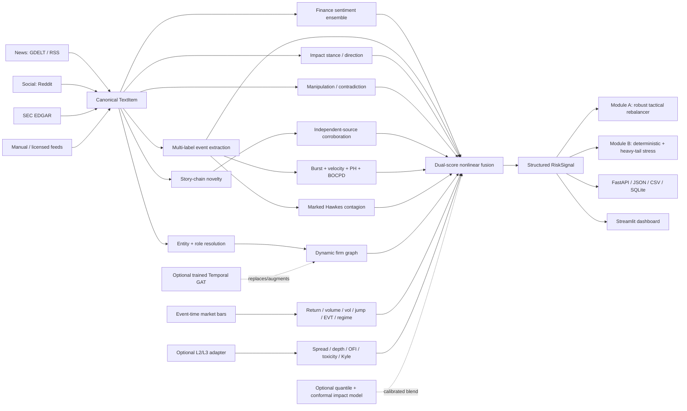

# AegisSignal-X architecture



## Design rule: independent evidence channels

One model is not asked to do everything. AegisSignal-X separates:

1. semantic understanding;
2. provenance/novelty/corroboration;
3. information arrival dynamics;
4. market and liquidity state;
5. graph/systemic contagion;
6. tail/regime statistics.

This prevents a sentiment classifier from becoming a fake crash oracle.

## Core structured output

Each issuer-level `RiskSignal` contains:

- sentiment and ensemble disagreement;
- primary + secondary event classes;
- harmful/beneficial event direction;
- conditional impact (1–10);
- early-warning score;
- risk-priority score + alert level;
- story cluster / duplicate probability;
- corroboration, contradiction and source independence;
- burst, risk velocity, Page-Hinkley/BOCPD change signal;
- Hawkes contagion;
- graph/systemic contagion;
- market, microstructure, EVT-tail and regime stress;
- manipulation/uncertainty;
- model confidence;
- per-channel contribution trace.

## Dependency profiles

### Core/offline

Runs with deterministic financial-language fallbacks and no model downloads. This mode is for reproducibility, unit tests and demonstrations — not maximum NLP accuracy.

### MAX

`requirements-max.txt` adds PyTorch, Transformers and sentence-transformers. Enable with:

```bash
export AEGIS_USE_TRANSFORMERS=true
export AEGIS_MAX_PROFILE=true
```

MAX uses a finance sentiment ensemble, NLI event classifier and semantic story embeddings.

## Production boundary

The repository contains adapters for stronger signals but deliberately does not pretend to include data it cannot legally/publicly ship: exchange message feeds, proprietary news wires, private counterparty graphs, licensed satellite/maritime data, options/dealer positioning or confidential bank exposures.
